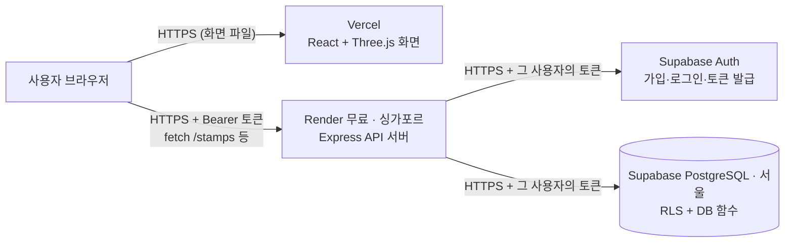

# SceneWalk 실제 구성도와 구간별 방어 (담당: 지민)

> 기준일: 2026-11-23. 실제로 배포·운영 중인 것만 적었다. 직접 운영하지 않는 장비(Nginx, 방화벽)는 그리지 않았다.

## 1. 요청이 지나가는 길

- 화면은 Vercel에서 받고, 데이터 요청은 브라우저가 Render 서버로 직접 보낸다 (Vercel을 거치지 않음)
- Render 서버는 Supabase에 **로그인한 사람의 토큰을 그대로** 실어 보낸다. 서버만의 강한 키(service_role)가 없다

## 2. 구간별로 무엇이 막아 주나

| 구간 | 막는 것 | 어떻게 | 근거 |
|---|---|---|---|
| 브라우저 ↔ Vercel·Render·Supabase | 도청·변조 | 세 곳 모두 HTTPS만 씀 (인증서는 각 플랫폼이 자동 관리) | 배포 주소가 모두 https |
| 브라우저 → Render | 다른 사이트가 우리 API를 몰래 호출 | CORS 허용 목록(`ALLOWED_ORIGINS`)에 있는 화면 주소만 | `server/src/app.js` CORS 설정 |
| 〃 | 큰 요청으로 서버 괴롭히기 | JSON 본문 10KB 제한, 입력 길이 검사 | `express.json({ limit: '10kb' })`, `requireString` |
| 〃 | 무차별 대입(비밀번호 찍기) | IP당 로그인·가입 15분 30번, 이메일당 실패 15분 5번 → 429 + Retry-After | `server/src/rateLimit.js`, `server/test/rateLimit.test.js` |
| 〃 | 위조·만료 토큰 | 서명·만료 검사는 Supabase Auth에 맡김(`auth.getUser`), 실패하면 401이고 DB는 안 부름 | `requireAuth`, `server/test/app.test.js` |
| 〃 | 내부 정보 노출 | 예상 못 한 에러는 "잠시 뒤에 다시"로 숨기고 서버 로그에만 남김, `x-powered-by` 끔 | `server/src/errors.js` |
| Render → Supabase | 서버가 털리면 DB 전체가 털림 | 서버에는 공개돼도 되는 publishable 키뿐, service_role 키 없음 | `server/src/supabase.js`, `server/.env.example` |
| Supabase DB 안 | 서버 코드 버그로 남의 데이터 접근 | 모든 테이블 RLS + 쓰기는 DB 함수로만. 막히면 읽기는 0건, 직접 쓰기는 42501 | `supabase/tests/jm_security_matrix_test.sql` |
| 〃 | 스스로 관리자·사장님 되기 | 역할·가게 변경은 트리거가 FORBIDDEN | `guard_profile_update` |
| 〃 | 스탬프·쿠폰 중복, 동시 요청 | UNIQUE 제약 + 조건부 UPDATE + 멱등성 키 | `jm_core_test.sql` |
| 〃 | 누가 무엇을 바꿨는지 모름 | 역할 변경·가게 문구·쿠폰 사용을 감사 로그에 자동 기록, 관리자만 읽고 아무도 못 고침 | `20261125120000_jm_audit_log.sql`, `jm_audit_log_test.sql` |

## 3. 일부러 안 한 것과 이유

| 항목 | 이유 |
|---|---|
| Nginx 리버스 프록시·방화벽 설정 | Vercel·Render·Supabase가 앞단 프록시·TLS를 대신 운영한다. 직접 설정할 서버가 없다 |
| 비밀번호 해시·토큰 발급 직접 구현 | Supabase Auth가 맡는다(11/18 결정). 직접 만들면 실수가 곧 구멍이 된다 |
| IP 허용 목록 | 무료 플랜 원칙. 관리자 접근은 감사 로그로 추적하고, 2단계 인증(TOTP)은 시간이 남으면 넣는다 |

## 4. 알려진 한계

- Render 무료는 15분 동안 요청이 없으면 잠든다 [가능성 높음]. 첫 요청이 수십 초 걸리므로 시연 전에 `/health`로 깨워 둔다
- 로그인 시도 제한은 서버 메모리에 센다. 재시작하면 초기화되고, 서버가 여러 대가 되면 공용 저장소(Redis 등)가 필요하다
- Supabase Auth의 자체 IP 제한은 모든 요청이 Render IP 하나로 보이므로 사용자별 구분이 안 된다. 그래서 서버 쪽 제한을 따로 뒀다
