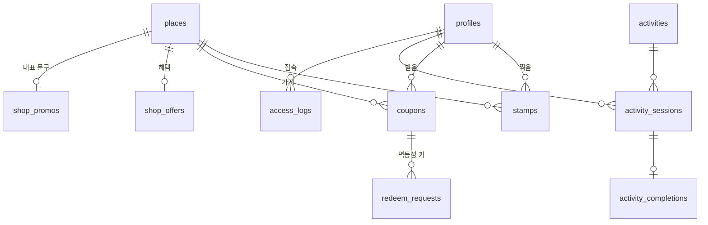

# JM(지민) 담당 DB 설계 — 스탬프 · 쿠폰 · 체험 · 접속 기록 · 역할

> 상태: **초안 (로컬 검증 완료, Supabase 미적용)**
> 파일: `supabase/migrations/20261118120000_jm_core.sql` (테이블·RLS·함수), `supabase/seed.sql` (장소·혜택·체험, `node supabase/gen_seed.mjs`로 생성), `supabase/tests/jm_core_test.sql` (규칙 검증 22개)
> 검증: PostgreSQL 18(PGlite)에서 마이그레이션 → 시드 → 검증 22개 모두 통과. 규칙을 일부러 망가뜨리면(RLS 해제, 조건부 갱신 제거, 역할 보호 제거) 검증이 실패하는 것까지 확인했습니다.

## 0. 먼저 팀과 정할 것

기획서에는 **Node.js + Express + JWT 서버(Render)가 로그인·스탬프·쿠폰·통계를 맡고, DB는 Supabase Postgres**로 되어 있습니다. 이 설계는 그 구조와 부딪치지 않습니다.

- 규칙(중복 차단·1회 사용·권한)은 **DB 안**(제약 + 함수)에 있습니다. 그래서 Express가 부르든 화면이 직접 부르든 똑같이 지켜집니다.
- Express에서 부를 때: 한 트랜잭션 안에서 `set_config('request.jwt.claims', '{"sub":"<사용자 id>"}', true)`와 `set local role authenticated`를 실행한 뒤 `select public.collect_stamp(...)`를 호출합니다. 그러면 RLS도 그대로 적용되어, 서버 코드에 실수가 있어도 DB가 한 번 더 막습니다.
- **결정 (2026-11-18): 로그인은 Supabase Auth.** 가입·로그인·비밀번호 저장·토큰 발급은 Supabase Auth가 맡습니다. Express는 요청 헤더의 Supabase JWT를 검증만 하고, 그 `sub`를 위 방식으로 DB에 넘깁니다.
  - 이유: 비밀번호 해시·재설정·이메일 인증을 직접 만들면 보안 실수 위험이 큽니다. 검증된 인증 서비스를 쓰고, 우리 코드는 "권한(누가 무엇을 할 수 있나)"에 집중합니다.
  - `profiles`는 `auth.users`와 1:1이고, 가입 트리거가 순례객 프로필을 자동으로 만듭니다.

## 1. 테이블

| 테이블 | 역할 | 핵심 제약 |
|---|---|---|
| `places` | 3D 맵 상호작용 지점 (`shared/places.json`과 같은 id) | `type in (spot, cafe, npc)` |
| `profiles` | 회원 이름·역할(순례객/사장님/관리자)·가게 | 사장님 ⇔ 가게 있음 (`owner_has_shop`) |
| `stamps` | 스탬프 | **UNIQUE (user_id, place_id)** — 중복 획득 차단 |
| `coupons` | 쿠폰 | **UNIQUE (user_id, shop_id)** — 가게당 1인 1장, 코드 6자리(0/O·1/I 제외) |
| `redeem_requests` | 쿠폰 사용 요청의 멱등성 키 | PK = idempotency_key |
| `activities` / `activity_sessions` / `activity_completions` | 체험(농구·정류장) 시작·완료 | 완료 **PK (user_id, activity_id)**, `min_seconds` |
| `access_logs` + 뷰 `daily_visitors` | 접속 기록, 일일 순 방문자 | 날짜는 **한국 시간** |
| `shop_promos` | 사장님 대표 홍보문구 | 가게당 1개 |

## 2. 판단 근거 (면접에서 설명할 부분)

**① "한 번만" 규칙은 앱이 아니라 DB가 막는다**
앱에서 "이미 찍었나?"를 조회한 뒤 저장하면, 두 요청이 동시에 오는 순간 둘 다 "아직 없음"으로 보고 두 번 저장됩니다(경쟁 상태). 그래서 UNIQUE 제약에 `INSERT … ON CONFLICT DO NOTHING`을 함께 써서, DB가 하나만 남기도록 했습니다.

**② 쿠폰 1회 사용 = 조건부 갱신**
`UPDATE coupons SET used_at = now() WHERE id = … AND used_at IS NULL`처럼 조건을 걸어 갱신합니다. 두 사장님 화면에서 동시에 눌러도 한쪽만 1행을 바꾸고, 다른 쪽은 0행이라 `COUPON_USED`가 됩니다. 따로 잠금을 잡지 않아도 됩니다.

**③ 멱등성 키 (과제 6에서 이어 온 방식)**
버튼을 두 번 누르거나 응답을 못 받아 재시도하면, 같은 요청인데 두 번째는 "이미 사용"이라는 에러가 뜹니다. 그래서 화면이 요청마다 UUID를 만들어 보내고, 같은 키가 다시 오면 처음 결과를 그대로 돌려줍니다(`replayed: true`). "에러가 안 난다"와 "두 번 처리되지 않는다"를 함께 만족합니다.

**④ 쓰기는 RPC로만, RLS에는 읽기 정책만**
테이블에 INSERT/UPDATE 정책을 열면 화면 코드를 우회해 원하는 값을 직접 넣을 수 있습니다. 쓰기는 검사가 들어 있는 `SECURITY DEFINER` 함수로만 하게 하고, RLS는 "누가 무엇을 볼 수 있나"만 정합니다.
- 순례객: 자기 스탬프·쿠폰·체험만 봅니다.
- 사장님: **자기 가게 쿠폰만** 봅니다. 다른 가게 쿠폰은 목록에서도 안 보이고, 사용 처리도 `WRONG_SHOP`으로 거부됩니다.
- 관리자: 접속 기록과 전체 프로필을 봅니다.
- 함수에는 모두 `set search_path = ''`를 걸었습니다(SECURITY DEFINER 함수를 노린 스키마 바꿔치기 방지).

**⑤ 권한 상승 차단**
`profiles` 이름 수정은 본인에게 허용합니다. 대신 트리거가 `role`·`shop_id` 변경을 관리자 외에는 막습니다. 그래서 "내 역할을 admin으로 바꾸기"는 RLS를 통과해도 실패합니다.

**⑥ 가짜 체험 완료 방지**
체험을 시작할 때 서버가 시각을 남기고, 완료 요청이 오면 **서버 시계로** 걸린 시간을 잽니다. `min_seconds`(농구 5초, 정류장 8초)보다 짧으면 `TOO_FAST`로 거부합니다. 브라우저 콘솔에서 완료 함수만 부르는 방식은 이것으로 막힙니다. 1분에 30번이 넘는 시작 요청도 거부합니다.
한계: 브라우저에서 도는 게임이라 "정말 3골을 넣었는지"는 서버가 알 수 없습니다. 시간 검사와 횟수 제한으로 비용을 올리는 수준입니다.

**⑦ 한국 시간 기준 집계**
서버(UTC) 날짜로 세면 한국 오전 0~9시 접속이 전날로 잡힙니다. 그래서 `kst_today()`(Asia/Seoul)로 날짜를 저장합니다. 일일 순 방문자는 `count(distinct user_id)`로 셉니다.

## 3. 함수 (RPC) ↔ 화면 `client.js`

| client.js (이름·응답 그대로) | RPC | 에러 코드 |
|---|---|---|
| `collectStamp({ placeId })` | `collect_stamp(p_place_id)` | `ALREADY_STAMPED`, `NOT_STAMPABLE`, `NOT_FOUND`, `UNAUTHORIZED` |
| `listMyStamps()` | `select … from stamps` (RLS) | — |
| `listMyCoupons()` | `select … from coupons` (RLS) | — |
| `redeemCoupon({ code })` | `redeem_coupon(p_code, p_idempotency_key)` | `NOT_OWNER`, `INVALID_CODE`, `NOT_FOUND`, `WRONG_SHOP`, `COUPON_EXPIRED`, `COUPON_USED` |
| `getShopStats()` | `get_shop_stats()` | `NOT_OWNER` |
| `saveShopPromo({ text, tag })` | `save_shop_promo(p_text, p_tag)` | `NOT_OWNER` |
| (새) 체험 시작/완료 | `start_activity(id)` → `complete_activity(session)` | `TOO_FAST`, `TOO_MANY_REQUESTS`, `NOT_FOUND` |
| (새) 로그인 직후 | `log_access()` | — |

- 에러는 PostgreSQL 예외 `message`에 코드가 들어 있습니다. client.js에서 `new ApiError(error.message, error.details)`로 바꾸면 지금 화면의 안내 문구가 그대로 동작합니다.
- 화면이 넘기는 `userId`·`ownerId`는 서버에서 쓰지 않습니다. 누구인지는 로그인 토큰(`auth.uid()`)으로만 판단합니다(남의 id를 넣어 보내는 공격 차단). 함수 이름·응답 모양은 유지되지만, 인자에서 `userId`가 빠지는 점은 팀에 공유가 필요합니다.

## 4. 적용 순서

1. Supabase 프로젝트 만들기 (지민 계정)
2. SQL Editor에서 `migrations/…_jm_core.sql` → `seed.sql` 실행
3. `tests/jm_core_test.sql` 실행 → NOTICE에 PASS 22개와 "모든 검사 통과"가 나오는지 확인 (마지막이 rollback이라 데이터는 남지 않음)
4. 사장님·관리자 계정은 SQL로 역할 지정: `update profiles set role='owner', shop_id='shop_hj_snack' where id='…'`
5. client.js 안쪽을 RPC 호출로 교체 (팀 합의 후), Vercel 환경 변수 `VITE_SUPABASE_URL`, `VITE_SUPABASE_ANON_KEY` (anon 키는 공개돼도 되는 키이고, 실제 보호는 RLS가 합니다. service_role 키는 절대 화면에 넣지 않습니다.)

## 5. 질의응답 대비

- **쿠폰 이중 사용은?** 조건부 갱신(②)과 멱등성 키(③)로 막습니다. 동시에 눌러도 1번만 처리되고, 재시도에는 같은 결과를 돌려줍니다.
- **가짜 스탬프는?** 쓰기는 RPC로만 하고, 사용자는 토큰에서 꺼냅니다. 중복은 UNIQUE가 막습니다. 다만 "실제로 그 장소에 갔는지"는 브라우저 게임 특성상 검증하지 못합니다(한계로 인정).
- **다른 가게 쿠폰 처리는?** RLS로 목록에서 안 보이고, 함수에서도 `WRONG_SHOP`으로 거부합니다. 두 겹으로 막습니다.
- **역할 권한 구조는?** pilgrim / owner(가게 1개 필수) / admin. 역할 변경은 관리자만 가능하고, 트리거로 강제합니다.
- **일일 접속자 기준은?** 한국 날짜 기준 순 인원입니다. 같은 날 여러 번 접속해도 1명으로 셉니다.
