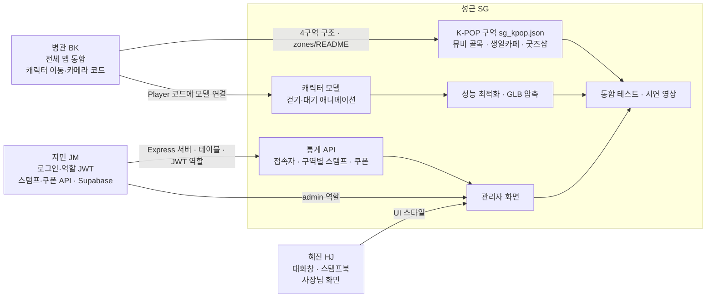
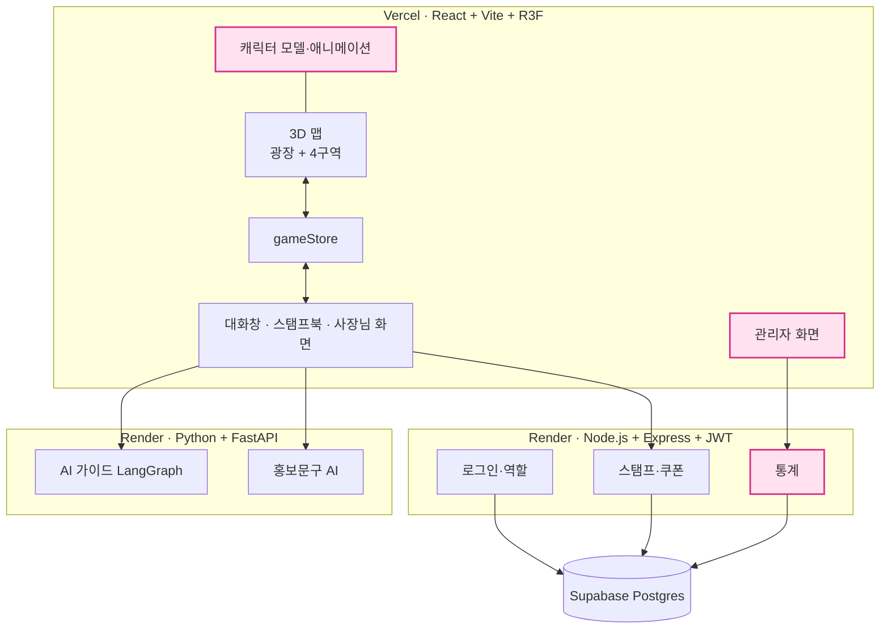
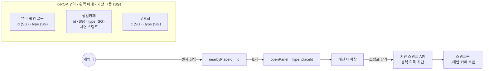
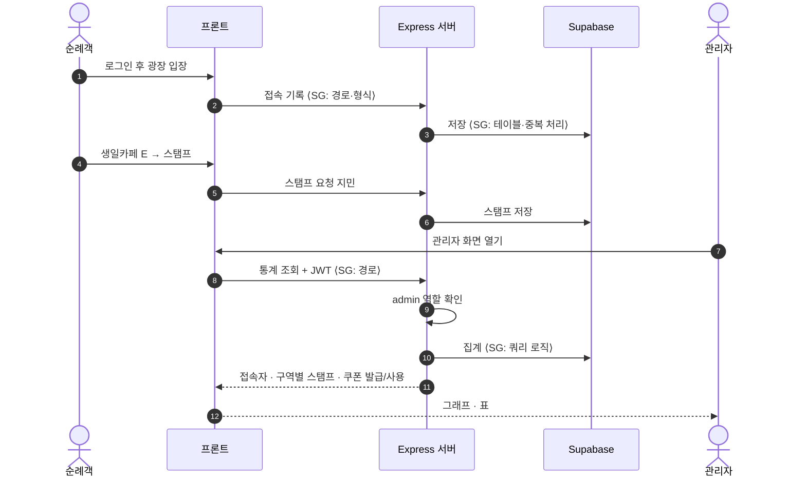
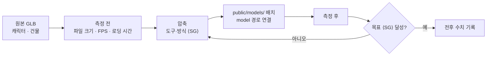
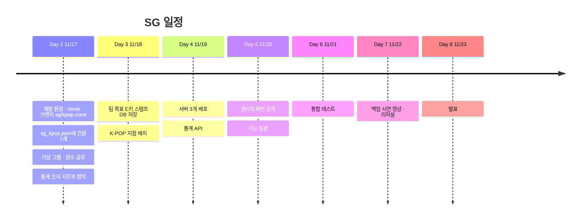

# SG(성근) 담당 설계 뼈대

> 상태: **뼈대**. 흐름과 제약만 적었습니다. `⟨SG⟩` 표시가 있는 곳(id, API 경로, 테이블, 내부 로직, 도구)은 SG가 정해진 범위 안에서 직접 정합니다.
> 목적: 포트폴리오용 캡스톤. 대회 준비작이 아니다.
> 근거: 「SceneWalk AI 한 장 기획서 (4인)」(2026-11-17), 배포 사이트 https://aleph-capstone.vercel.app/, 이 폴더의 코드

## 0. 확인한 사실

**기획서 기준**
- 맵: 가운데 광장(시작 지점, NPC 루미)에서 십자 큰길로 네 구역에 갑니다. **K-POP은 왼쪽 아래**입니다.
- 건물 높이 규칙은 6~12m입니다. 예외는 데이트 구역 전망대 하나입니다.
- 구역 파일: `frontend/src/game/data/zones/내코드_xxx.json` → SG는 `sg_kpop.json`. 같은 폴더의 `README.md`를 먼저 읽습니다.
- 서버: Node.js + Express + JWT(로그인·스탬프·쿠폰·**통계**)와 Python + FastAPI(AI)를 각각 Render에 둡니다. DB는 Supabase Postgres입니다.
- 4구역 맵 구조는 Day 2(11/17)에 배포 완료입니다.

**이 폴더(`Aleph_Capstone-SG`)의 상태**
- git 저장소가 아니고, `zones/` 폴더도 없습니다. 맵이 `buildings.json` 하나에 A~D 일자형으로 들어 있는 **구버전**입니다.
- 그래서 실제 작업은 GitHub Desktop으로 clone한 저장소에서 해야 합니다.

**코드 계약 (구버전 기준, 새 버전에서 다시 확인 필요)**
- 3D와 UI는 `gameStore`(zustand)로만 연결됩니다: `nearbyPlaceId`, `openPanel = { type, placeId }`, `open`, `close`
- 상호작용 지점의 `type`: `spot | cafe | npc`
- 3D 모델은 `"model": "/models/xxx.glb"`로 불러오고, 실패하면 코드로 그린 모양으로 대체합니다.

---

## 1. 담당 범위와 받는 일

---

## 2. 전체 구조 속 내 위치

분홍색이 SG 담당입니다. 통계 API는 지민님 Express 서버 안에 들어갑니다.

---

## 3. K-POP 구역: 장소와 상호작용 흐름

**제약 (정해진 범위)**
- 수정 가능한 파일은 `zones/sg_kpop.json` 하나입니다. 형식은 `zones/README.md`를 따릅니다.
- 건물 높이는 6~12m입니다.
- `type`을 새로 만들면 UI가 열 패널이 달라지므로 혜진님과 합의가 필요합니다.
- 실존 그룹, 곡, 로고는 쓰지 않습니다.

---

## 4. 통계 데이터 흐름

보여줄 숫자 후보(기획서): 일일 접속자 수, 구역별 스탬프 수, 쿠폰 발급·사용 수. 지민님과 15분 맞추기로 되어 있습니다.

---

## 5. 성능 최적화: 캐릭터와 GLB

캐릭터 모델은 걷기·대기 애니메이션이 필요합니다. 모델을 어디서 구할지, 라이선스는 어떤지 정해야 합니다.

---

## 6. 일정 (기획서 기준, Day 1 = 11/16)

캐릭터 모델과 GLB 압축은 Day 5 기능 동결 전에 할지 뒤에 할지 정해야 합니다. 성능 작업은 동결 뒤에도 할 수 있는지 팀 확인이 필요합니다.

---

## 7. 팀에 물어볼 것

1. 스탬프 테이블에 구역 정보가 있는지, 접속 기록용 테이블을 추가해도 되는지 (지민)
2. 관리자 역할을 JWT에서 어떻게 확인하는지 (지민)
3. 새 `type`을 쓰게 되면 UI 패널을 어떻게 처리할지 (혜진)
4. 관리자 화면 디자인을 사장님 화면과 맞출지 (혜진)
5. 캐릭터 모델을 Player 코드에 어떻게 연결할지 (병관)
6. 성능 최적화를 기능 동결 뒤에도 해도 되는지 (팀)
